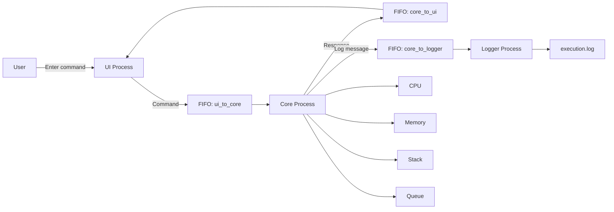

# 3-Process OS Simulator

## 1. Overview

This project is a multi-process Operating Systems simulator consisting of three independent processes:

- **UI Process** – Accepts commands from the user.
- **Core Process** – Processes commands and simulates CPU, Memory, Stack and Queue.
- **Logger Process** – Records executed commands and results.

The three processes communicate using **POSIX Named Pipes (FIFO)** for Inter-Process Communication (IPC).

In addition to the three-process simulator, the project demonstrates six additional IPC mechanisms through independent C implementations on Linux.

---

## 2. Team Roles

### Three-Process OS Simulator

| Member | Role |
|---|---|
| Haneena | UI Process |
| Ayman | Core Process |
| Vishnu | Logger Process |
| Isha | Team Leader / Integration |

---

## 3. Architecture



---

## 4. Communication Flow

The communication between the three processes follows these steps:

1. The user enters a command through the UI Process.
2. The UI Process sends the command to the Core Process using `ui_to_core`.
3. The Core Process receives and processes the command.
4. The Core Process sends the result back to the UI Process using `core_to_ui`.
5. The Core Process sends a log message to the Logger Process using `core_to_logger`.
6. The Logger Process receives the message and records the activity in `execution.log`.

---

## 5. IPC Mechanism Used in the Simulator

The three-process simulator uses **POSIX Named Pipes (FIFO)** for Inter-Process Communication.

### FIFO Channels

| FIFO | Communication |
|---|---|
| `ui_to_core` | UI → Core |
| `core_to_ui` | Core → UI |
| `core_to_logger` | Core → Logger |

Named Pipes were selected because they provide a simple and direct way for independent processes to exchange data on Linux.

---

## 6. Core Process

The Core Process simulates basic operating-system components:

- CPU
- Memory
- Stack
- Queue

It receives commands from the UI Process, executes the corresponding operation and sends a response back.

### Supported Commands

| Command | Description |
|---|---|
| `start` | Starts CPU execution |
| `status` | Displays the status of CPU, Memory, Stack and Queue |
| `stop` | Stops CPU execution |
| `exit` | Shuts down the simulator |

### Example Output

```text
Enter command: status

[CORE RESPONSE] CPU: RUNNING | Memory: ACTIVE | Stack: ACTIVE | Queue: ACTIVE
```

---

## 7. Logger Process

The Logger Process receives messages from the Core Process through the `core_to_logger` FIFO.

It performs two main operations:

- Displays log messages received from the Core Process.
- Stores execution information in `execution.log`.

The log contains information about commands executed by the Core Process.

### Example Output

```text
[LOGGER] Core executed command: start
[LOGGER] Core executed command: status
[LOGGER] Core executed command: stop
```

---

## 8. Project Structure

```text
3-process-os-simulator/
│
├── ui/
│   └── ui.c
│
├── core/
│   └── core.c
│
├── logger/
│   └── logger.c
│
├── fifos/
│   └── .gitkeep
│
├── ipc_implementations/
│   │
│   ├── ordinary_pipes/
│   │   └── pipe.c
│   │
│   ├── message_queues/
│   │   ├── sender.c
│   │   └── reciever.c
│   │
│   ├── shared_memory/
│   │   ├── writer.c
│   │   └── reader.c
│   │
│   ├── semaphores/
│   │   └── semaphore.c
│   │
│   ├── signals/
│   │   ├── signal_sender.c
│   │   └── signal_reciever.c
│   │
│   └── sockets/
│       ├── server.c
│       └── client.c
│
├── benchmark/
│   ├── benchmark.c
│   └── standalone.c
│
├── docs/
│   ├── IPC_Justification.md
│   ├── IPC_Test_Cases.md
│   └── Benchmark_Results.md
│
├── launcher.c
├── Makefile
├── benchmark.sh
├── simulator.log
├── .gitignore
└── README.md
```

---

## 9. Compilation

The three-process simulator can be compiled using the Makefile.

Navigate to the project directory:

```bash
cd ~/projects/PBL-OS-/Week2/3-process-os-simulator
```

Compile the simulator:

```bash
make
```

To remove compiled files:

```bash
make clean
```

### Creating the FIFOs

The required FIFO files can be created using:

```bash
mkfifo fifos/ui_to_core
mkfifo fifos/core_to_ui
mkfifo fifos/core_to_logger
```

The FIFOs are runtime communication channels and are not stored as normal source files in GitHub.

---

## 10. Running the Three-Process Simulator

### Using Launcher

The simulator can be started using the launcher:

```bash
./launcher
```

The launcher starts the UI, Core and Logger processes.

### Manual Execution

The processes can also be started manually.

Start the Logger Process first:

```bash
./logger/logger
```

Then start the Core Process:

```bash
./core/core
```

Finally start the UI Process:

```bash
./ui/ui
```

Enter commands at the UI prompt:

```text
start
status
stop
exit
```

### Example Output

**UI Process**

```text
Enter command: start
[CORE RESPONSE] CPU execution started.

Enter command: status
[CORE RESPONSE] CPU: RUNNING | Memory: ACTIVE | Stack: ACTIVE | Queue: ACTIVE

Enter command: stop
[CORE RESPONSE] CPU execution stopped.
```

**Logger Process**

```text
[LOGGER] Core executed command: start
[LOGGER] Core executed command: status
[LOGGER] Core executed command: stop
```

---

## 11. Benchmark

A benchmark program is included to measure execution time.

The benchmark performs a computational workload and measures CPU execution time.

### Baseline Benchmark Result

```text
Execution time: 0.339687 seconds
```

The benchmark is used as a baseline for performance analysis.

A comparison between standalone and multi-process execution will be recorded as part of the performance evaluation.

---

## 12. Testing the Three-Process Simulator

The following IPC test cases are considered:

| Test Case | Input | Expected Result |
|---|---|---|
| TC01 | `start` | Core starts CPU execution |
| TC02 | `status` | CPU, Memory, Stack and Queue status displayed |
| TC03 | `stop` | Core stops CPU execution |
| TC04 | `exit` | Processes shut down correctly |
| TC05 | Invalid command | Core returns `Unknown command.` |
| TC06 | Logging | Core command is received by Logger |

---

# 13. Additional IPC Implementations

Apart from POSIX Named Pipes (FIFO) used in the three-process simulator, the project includes six additional IPC implementations using C on Linux.

These implementations demonstrate different methods through which processes communicate, exchange data and synchronize their execution.

## 13.1 Implemented IPC Techniques

| No. | IPC Technique | Implementation |
|---|---|---|
| 1 | Ordinary Pipes | Parent-child process communication |
| 2 | Named Pipes (FIFO) | UI-Core-Logger communication |
| 3 | Message Queues | Message exchange using System V IPC |
| 4 | Shared Memory | Data sharing between processes |
| 5 | Semaphores | Process synchronization |
| 6 | Signals | Process event notification |
| 7 | Sockets | Client-server communication using TCP |

## 13.2 Additional IPC Implementation Details

### 1. Ordinary Pipes

- Uses the `pipe()` system call.
- Provides communication between related processes.
- The parent process sends data through the pipe.
- The child process receives the data.

### 2. Named Pipes (FIFO)

- Uses named pipes for communication between independent processes.
- FIFO files provide communication channels through the filesystem.
- Used in the three-process simulator.

### 3. Message Queues

- Uses System V message queue functions.
- Allows processes to exchange messages through a kernel-managed queue.
- Uses `msgget()`, `msgsnd()`, `msgrcv()` and `msgctl()`.

### 4. Shared Memory

- Allows multiple processes to access a common memory region.
- Uses POSIX shared memory functions.
- The writer stores data in shared memory, and the reader retrieves it.
- Uses `shm_open()`, `ftruncate()`, `mmap()` and `shm_unlink()`.

### 5. Semaphores

- Used for process synchronization.
- Controls access to shared resources.
- The child process waits using `sem_wait()`.
- The parent process signals using `sem_post()`.

### 6. Signals

- Used to notify a process about an event.
- The receiver waits for a signal.
- The sender sends a signal using `kill()`.
- Uses `SIGUSR1` for communication.

### 7. Sockets

- Enables communication between processes using a client-server model.
- Uses TCP sockets on localhost.
- The client sends a message to the server.
- The server receives the message and sends a response.

---

## 13.3 Additional IPC Team Allocation

| Member | Responsibility |
|---|---|
| Isha | Shared Memory and Semaphores |
| Haneena | Message Queues |
| Ayman | Ordinary Pipes and Signals |
| Vishnu | Sockets |

---

## 13.4 Compilation of Additional IPC Implementations

Navigate to the project directory:

```bash
cd ~/projects/PBL-OS-/Week2/3-process-os-simulator
```

Compile the implementations using GCC:

**Ordinary Pipes**

```bash
gcc ipc_implementations/ordinary_pipes/pipe.c -o ipc_implementations/ordinary_pipes/pipe
```

**Message Queues**

```bash
gcc ipc_implementations/message_queues/sender.c -o ipc_implementations/message_queues/sender

gcc ipc_implementations/message_queues/reciever.c -o ipc_implementations/message_queues/reciever
```

**Shared Memory**

```bash
gcc ipc_implementations/shared_memory/writer.c -o ipc_implementations/shared_memory/writer -pthread -lrt

gcc ipc_implementations/shared_memory/reader.c -o ipc_implementations/shared_memory/reader -pthread -lrt
```

**Semaphores**

```bash
gcc ipc_implementations/semaphores/semaphore.c -o ipc_implementations/semaphores/semaphore -pthread
```

**Signals**

```bash
gcc ipc_implementations/signals/signal_sender.c -o ipc_implementations/signals/signal_sender

gcc ipc_implementations/signals/signal_reciever.c -o ipc_implementations/signals/signal_reciever
```

**Sockets**

```bash
gcc ipc_implementations/sockets/server.c -o ipc_implementations/sockets/server

gcc ipc_implementations/sockets/client.c -o ipc_implementations/sockets/client
```

---

## 13.5 Execution of Additional IPC Implementations

### 1. Ordinary Pipes

Run:

```bash
./ipc_implementations/ordinary_pipes/pipe
```

### 2. Message Queues

Open two terminals.

**Terminal 1 – Receiver**

```bash
./ipc_implementations/message_queues/reciever
```

**Terminal 2 – Sender**

```bash
./ipc_implementations/message_queues/sender
```

Enter a test message when prompted.

### 3. Shared Memory

Run the writer first:

```bash
./ipc_implementations/shared_memory/writer
```

Then run the reader:

```bash
./ipc_implementations/shared_memory/reader
```

### 4. Semaphores

Run:

```bash
./ipc_implementations/semaphores/semaphore
```

### 5. Signals

The receiver is started in the background. Its actual process ID is automatically passed to the sender.

Run:

```bash
./ipc_implementations/signals/signal_reciever &
RECEIVER_PID=$!

sleep 1

echo "Receiver PID: $RECEIVER_PID"

./ipc_implementations/signals/signal_sender "$RECEIVER_PID"

wait "$RECEIVER_PID"
```

### 6. Sockets

Open two terminals.

**Terminal 1 – Server**

```bash
./ipc_implementations/sockets/server
```

**Terminal 2 – Client**

```bash
./ipc_implementations/sockets/client
```

---

## 13.6 Testing and Results of Additional IPC Implementations

Each additional IPC implementation was independently compiled and executed in Ubuntu Linux using GCC.

The following outputs were observed during testing.

### 1. Ordinary Pipes

```text
Parent: Sending message to child
Child: Received message: Hello from parent
```

**Result:** Parent successfully transmitted a message to the child process.

### 2. Message Queues

```text
Waiting for message...
Received message: hello from isha
Message queue deleted.
```

**Result:** Receiver successfully retrieved the message from the message queue.

### 3. Shared Memory

```text
Reader: Data received successfully.
Reader received: Hello from Shared Memory!
```

**Result:** Reader successfully retrieved data written to shared memory.

### 4. Semaphores

```text
Child: Waiting for semaphore...
Parent: Sending semaphore signal.
Child: Semaphore received!
Child: Critical operation completed.
Parent: Child process completed.
```

**Result:** Child process successfully continued execution after receiving the semaphore signal.

### 5. Signals

```text
Receiver: Waiting for signal...
Receiver PID: 11697

Receiver: Signal received successfully!
Sender: Signal sent successfully!
```

**Result:** Receiver successfully handled the signal sent by the sender.

### 6. Sockets

**Client Output**

```text
Client: Message sent!
Client received: Hello from server!
```

**Server Output**

```text
Server: Waiting for client...
Server received: Hello from client!
Server: Response sent!
```

**Result:** Client and server successfully exchanged messages through TCP sockets.

---

## 13.7 Overall IPC Testing Summary

| No. | IPC Technique | Testing Result |
|---|---|---|
| 1 | Ordinary Pipes | Passed |
| 2 | Named Pipes (FIFO) | Passed |
| 3 | Message Queues | Passed |
| 4 | Shared Memory | Passed |
| 5 | Semaphores | Passed |
| 6 | Signals | Passed |
| 7 | Sockets | Passed |

**Overall Result: All seven IPC mechanisms passed their basic functional tests.**

Detailed execution outputs and observations are documented in the IPC Testing Report.

---

## 14. GitHub and Integration

The Team Leader integrates the independently developed UI, Core and Logger processes and verifies communication between them.

The integration includes:

- UI → Core communication.
- Core → UI response.
- Core → Logger communication.
- FIFO creation.
- Process testing.
- Benchmarking.
- Documentation.

The additional IPC implementations are maintained separately inside the `ipc_implementations/` directory and can be compiled and executed independently.

---

## 15. Conclusion

The project demonstrates a three-process operating-system simulator using POSIX Named Pipes for Inter-Process Communication.

The final system separates the user interface, core simulation and logging functionality into independent processes while allowing them to communicate through FIFO channels.

In addition, six independent IPC implementations demonstrate Ordinary Pipes, Message Queues, Shared Memory, Semaphores, Signals and Sockets.

Through these implementations, the project provides practical understanding of inter-process communication, data sharing, message exchange, process synchronization and client-server communication in Linux.

All seven IPC mechanisms were successfully compiled and tested for their basic functionality.
